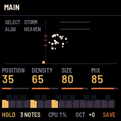

# GRAIN PIANO – Handbuch

**Eine Firmware für das M-VAVE FM-1 von swtdr34mz.**
Ein einziges Instrument: ein gesampelter Konzertflügel (Salamander Grand Piano), den ein Granulator in winzige
Körnchen („Grains“) zerlegt. Daraus entstehen schwebende Wolken, glitzernde Flächen und Klänge zwischen den
Klaviertasten.

> Inoffiziell: nicht von M-VAVE hergestellt, unterstützt oder geprüft. Die Installation ersetzt die Firmware des
> FM-1 und kann die Garantie kosten. Auf eigene Gefahr.

---

## 1. Schnellstart

1. Spiel ein paar Töne. Du hörst den Flügel und darüber seine Grain-Wolke.
2. Dreh an **SELECT** und **ALGORITHM**: die zwei Makros des Presets, die es richtig aufleben lassen.
3. Dreh am **PRESET**-Regler: CONCERT GRAND, FELT PIANO, CLOUD, AURORA, MIDNIGHT RAIN, DREAMCORE, UNDERWATER,
   STARDUST.
4. Drück **PLAY** (HOLD an). Spiel einen Akkord: Er klingt weiter, und du hast beide Hände für die Regler frei.
5. Dreh an **K1–K4**. Welche Seite gerade aktiv ist, zeigt der leuchtende Knopf.
6. Drück **SAVE**, um deine Einstellungen zu behalten. SAVE leuchtet, wenn sich etwas geändert hat.

## 2. Wie GRAIN PIANO klingt

Jede Note spielt **zwei Dinge gleichzeitig**:

- **den Flügel selbst**, also den echten Klavierton, und
- **Grains**: winzige Stücke aus demselben Klavierton, 15 bis 600 Millisekunden lang. Sie werden an einer Stelle
  im Ton gelesen, die vom Hammeranschlag bis zum Ausklang reicht.

Diese Stelle (**POSITION**) kann langsam durch den Ton wandern oder stillstehen (**FREEZE**). Steht sie still, wird
ein gehaltener Ton zu einer Wolke, die nie aufhört.

## 3. Die Bedienelemente

| Element | Funktion |
| --- | --- |
| Tasten | Klavier, mit Anschlagsdynamik. Die Tasten F3–C5 messen auch den Druck (siehe PRESSURE). |
| OCT− / OCT+ | Oktave, −2 bis +2 |
| PRESET-Regler | Preset wählen. Jedes Preset merkt sich deine Änderungen. |
| SELECT-Regler | Makro 1 des Presets (Kapitel 5) |
| ALGORITHM-Regler | Makro 2 des Presets (Kapitel 5) |
| K1–K4 | die vier Regler der aktiven Seite |
| HOME | Hauptseite mit der Wolke. **1 s halten:** Das Preset wird auf Werkseinstellung zurückgesetzt. |
| PLAY | **HOLD** an/aus (leuchtet grün). **0,8 s halten:** alle gehaltenen Töne aus. |
| REC | **MEMORY** einfrieren / ausblenden |
| SAVE | Einstellungen speichern |
| MASTER | Lautstärke |

Unten im Display stehen HOLD mit der Anzahl gehaltener Töne, **CPU** (die Auslastung des Chips; ab etwa 85 % wird
die Zahl orange), die Oktave und SAVE, wenn es etwas zu speichern gibt.

## 4. Die Seiten

**HOME – Hauptseite:** POSITION · DENSITY · SIZE · MIX.
Die Wolke im Display: Links ist der Hammeranschlag, rechts der Ausklang. Jeder Punkt ist ein Grain, je heller,
desto lauter. Die gepunkteten Linien zeigen, wo jede gespielte Note gerade gelesen wird. Das goldene Quadrat
unten zeigt POSITION. Oben links stehen die zwei Makros (SELECT, ALGORITHM).

### SEL – PIANO
| Regler | Funktion |
| --- | --- |
| PRESET | das Preset |
| TONE | dunkel ↔ hell |
| DYNAMICS | wie stark der Anschlag Lautstärke und Helligkeit ändert |
| MIX | nur Klavier ↔ nur Grains |

### EDIT – GRAINS
| Regler | Funktion |
| --- | --- |
| SIZE | Länge der Grains: kurz und körnig ↔ lang und weich |
| DENSITY | wie viele Grains pro Sekunde (0 = keine) |
| POSITION | wo im Ton gelesen wird: Hammer ↔ Ausklang |
| SPRAY | Streuung in Position und Tonhöhe. Ab der Mitte kommen ab und zu Oktaven und Quinten dazu. |

### ENV – ENVELOPE
| Regler | Funktion |
| --- | --- |
| ATTACK | wie weich der Ton einsetzt (bis 4 s: das Klavier „schwillt an“) |
| RELEASE | wie lange die Grains nach dem Loslassen ausklingen |
| PEDAL | Dämpfer des Klaviers: kurz ↔ wie mit gedrücktem Pedal |
| FREEZE | wie schnell die Position durch den Ton wandert. Ganz aufgedreht steht sie still: endlose Wolke. |

### LFO – MOVEMENT
| Regler | Funktion |
| --- | --- |
| RATE | Tempo der Bewegung |
| DEPTH | Stärke |
| TARGET | was sich bewegt: POSITION, PITCH (Tonhöhe), FILTER, PAN (links/rechts) |
| WOBBLE | leichtes Leiern wie bei einem alten Tonband |

### FX – ROOM
| Regler | Funktion |
| --- | --- |
| ROOM | Raumgröße: Zimmer ↔ Kathedrale |
| REVERB | Hallanteil |
| DELAY | Echo (Ping-Pong, links/rechts) |
| FELT | gedämpftes Filz-Klavier: weicher Anschlag, warm, dunkel |

### GLO – MAGIC
| Regler | Funktion |
| --- | --- |
| REVERSE | Anteil der Grains, die **rückwärts** laufen |
| HALO | Grains werden in Akkord-Intervalle gestimmt: OCTAVE, FIFTH, OCT+5TH, MAJOR, MINOR, SUS, MAJ9 |
| HALO MIX | wie viele Grains den HALO bekommen |
| WIDTH | Stereobreite der Wolke |

### GLO nochmal – MAGIC 2
| Regler | Funktion |
| --- | --- |
| PRESSURE | was fester Tastendruck bewirkt: DENSITY (mehr Grains), POSITION (Sprung nach hinten im Ton), VIBRATO, SWELL (lauter) |
| AMOUNT | wie stark der Druck wirkt |
| MEMORY | Lautstärke der MEMORY-Wolke |
| WANDER | wie schnell die MEMORY-Wolke durch die Phrase wandert (0 = steht still) |

### ARP – TEXTURE
| Regler | Funktion |
| --- | --- |
| TEXTURE | ein Geräusch unter dem Klavier: RAIN, VINYL, TAPE, WIND, SEA, ROOM. Alles wird im FM-1 selbst erzeugt, es gibt keine Aufnahmen. |
| LEVEL | Lautstärke |
| CHAR | Charakter: leicht ↔ heftig (Nieselregen ↔ Platzregen, ruhige ↔ hohe Wellen …) |
| REACT | Die Textur folgt deinem Spiel: lauter beim Spielen, leiser in den Pausen. |

### SEQ – SCALE (gilt für alle Presets)
| Regler | Funktion |
| --- | --- |
| SCALE | die Skala (siehe Kapitel 7) |
| ROOT | Grundton C … B |
| KEYS | SNAP: jede Taste rutscht auf den nächsten Skalenton darunter · WHITE: nur die weißen Tasten spielen die Skala, die schwarzen sind still · ALL: jede Taste ist der nächste Skalenton |
| LIGHT | Die Grundton-Tasten leuchten heller. |

### SEQ nochmal – PULSE
| Regler | Funktion |
| --- | --- |
| PULSE | Die Grains kommen in Schüben im Takt: OFF, 1/4, 1/8, 1/8T, 1/16, 1/32 |
| BPM | Tempo 70–170. Kommt eine MIDI-Clock an (z. B. von Ableton), folgt GRAIN PIANO ihr automatisch, dann steht dort „EXT“. |
| SWING | verschiebt jeden zweiten Schub |
| PUMP | Der Klang duckt sich auf jeden Schlag (Sidechain-Effekt). |

## 5. Die Makros: SELECT und ALGORITHM

**SELECT** und **ALGORITHM** sind pro Preset zwei **Makro-Regler**. Jeder dreht 6 bis 7 Parameter gleichzeitig.
Auf 0 klingt das Preset wie gespeichert, aufgedreht lebt es richtig auf. Die Namen und wie weit sie aufgedreht
sind, siehst du auf der Hauptseite.

| Preset | SELECT | ALGORITHM |
| --- | --- | --- |
| CONCERT GRAND | **BLOOM**: Der Flügel öffnet sich zur Wolke. | **SHIMMER**: Ein Halo aus Oktaven und Quinten steigt auf. |
| FELT PIANO | **DREAM**: driftet in einen Traum | **DUSTY**: eine alte Kassette voller Staub (Vinyl, Leiern) |
| CLOUD | **STORM**: ein Sturm aus verstreuten Grains, teils rückwärts | **HEAVEN**: Die Wolke hebt sich um Oktave und Quinte. |
| AURORA | **N. LIGHTS**: Die Lichter bewegen sich, Echos. | **SUPERNOVA**: zerspringt in glitzernde Sechzehntel |
| MIDNIGHT RAIN | **DOWNPOUR**: Der Regen wird stark. | **NEON**: Moll-Halo, Echos, dann ein langsamer Puls |
| DREAMCORE | **MELT**: Alles zerfließt. | **GLITCH**: Glitches in geswingten Sechzehnteln |
| UNDERWATER | **DEEPER**: hinab in die Tiefsee | **SURFACE**: hinauf zur Oberfläche, Licht bricht durch |
| STARDUST | **COSMOS**: hinaus ins All | **BEAT**: ein Lo-Fi-Beat |

Die Makros werden pro Preset gespeichert (SAVE). Die Seiten zeigen die Regler, wie du sie eingestellt hast, also
ohne den Anteil der Makros.

## 6. HOLD – die smarte Haltefunktion

**PLAY** schaltet HOLD ein (PLAY leuchtet). Dann klingt, was du spielst, weiter:

- Tasten, die du **zusammen** drückst (oder während eine noch unten ist), werden **ein Akkord**.
- Eine **neue Taste**, während keine Taste gedrückt ist, beginnt einen **neuen Akkord**. Der alte klingt mit RELEASE aus.
- Einen gehaltenen Ton **kurz allein antippen**: Nur dieser Ton verschwindet.
- Einen gehaltenen Ton **drücken und 0,4 s halten**: Mit ihm beginnt ein neuer Akkord.
- Es klingen **höchstens 8 Töne**, danach fällt der älteste weg.
- Gehaltene Töne bleiben beim Wechsel von Preset, Seite und Oktave erhalten. Ihre Tasten leuchten gedimmt.
- **PLAY 0,8 s halten:** alle gehaltenen Töne aus, HOLD bleibt an. **PLAY kurz:** HOLD aus.

Tipp: HOLD + FREEZE ganz auf + ein Akkord ergibt eine endlose Wolke, die du mit allen Seiten formen kannst.

## 7. Die Skalen

Weil GRAIN PIANO die Klavier-Samples stufenlos umstimmt, gibt es auch Skalen **zwischen** den Klaviertasten.

| Skala | Klang |
| --- | --- |
| CHROMATIC | ganz normal, alle Töne |
| MAJOR / MINOR | Dur / Moll |
| PHONK | dunkel, der halbe Schritt über dem Grundton (Phrygisch) |
| TRAP | der „dunkle Flöten“-Sound (harmonisches Moll) |
| DRILL | wie TRAP, mit noch mehr Spannung (ungarisches Moll) |
| LOFI | warm, nostalgisch (Dorisch) |
| DREAMCORE | schwebend, unwirklich (Lydisch) |
| ARABIC | der klassische „Wüsten“-Klang (doppelt-harmonisch) |
| MAQAM RAST | echtes Arabisch mit **Vierteltönen**: Die Terz liegt zwischen Dur und Moll. |
| OVERTONE | die Naturtonreihe: gläsern, leicht „schief“, außerirdisch |
| PELOG | die Stimmung indonesischer Gamelan-Orchester |
| FLOAT MAJ9 / FLOAT MIN11 | nur Akkordtöne: Jede Tastenkombination klingt wie ein fertiger Akkord. |
| ALIEN | Bohlen-Pierce: wiederholt sich nicht nach der Oktave, sondern nach Oktave plus Quinte |

Über MIDI geht bei Zwischentönen der nächstliegende normale Ton raus.

## 8. MEMORY

1. Spiel eine kurze Phrase.
2. Drück **REC**. Die letzten 2 Sekunden werden zu einer eigenen Wolke eingefroren. REC leuchtet, oben steht
   „MEM“.
3. Spiel darüber, die Wolke läuft weiter. Lautstärke und Bewegung stellst du auf MAGIC 2 ein (MEMORY, WANDER).
   SIZE, DENSITY, SPRAY, HALO und WIDTH wirken auch auf sie.
4. Drück **REC** nochmal: Die Wolke blendet langsam aus.

## 9. Die Presets

| Preset | Charakter |
| --- | --- |
| CONCERT GRAND | sauberer Flügel mit einem Hauch Grains |
| FELT PIANO | gedämpftes Filz-Klavier, intim |
| CLOUD | lange, schwebende Wolken |
| AURORA | CLOUD mit Oktave + Quinte darüber, breit, riesiger Raum |
| MIDNIGHT RAIN | Filz-Klavier im Regen, der Filter atmet |
| DREAMCORE | Grains rückwärts, Dur-Halo, leiernde Bandmaschine |
| UNDERWATER | dunkel, langsame Wellen, Meeresrauschen |
| STARDUST | Lo-Fi-Maj9-Staub auf Vinyl |

Jedes Preset merkt sich deine Änderungen, SAVE speichert sie dauerhaft. **HOME 1 s halten** setzt das aktuelle
Preset auf Werkseinstellung zurück.

## 10. MIDI

- **USB-MIDI in:** Noten spielen das Klavier, auf jedem Kanal.
- **USB-MIDI out:** Was du spielst, geht als Noten raus.
- **MIDI-Clock in:** PULSE folgt dem Tempo, BPM zeigt dann „EXT“.

## 11. Gut zu wissen

- **CPU-Anzeige:** Unter 85 % ist alles gut. Wird es knapp, lässt GRAIN PIANO für einen Moment ein paar Grains weg,
  statt zu knacksen.
- **Tastendruck** gibt es nur auf den Tasten F3–C5. Die sieben obersten Tasten haben keinen Drucksensor.
- **Speichern:** Erst SAVE speichert dauerhaft. Was nicht gespeichert ist, ist nach dem Ausschalten weg.

## 12. Credits

GRAIN PIANO von **swtdr34mz**, GPL-3.0. Flügel: **Salamander Grand Piano V3** von Alexander Holm (CC-BY 3.0).
Gebaut auf **fm1-base** (Charles Vestal) und **felucca-bsp** (Leo Kuroshita, Hügelton Instruments). Inspiriert von
**Tonitor** (Nuno Zimas). Schrift des Startbildschirms: **Press Start 2P** (SIL OFL 1.1).
