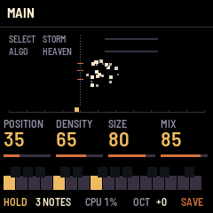

# GRAIN PIANO – Manual

**A firmware for the M-VAVE FM-1 by swtdr34mz.**
One instrument: a sampled concert grand (the Salamander Grand Piano) that a granulator breaks into tiny grains:
floating clouds, glittering pads, and notes between the piano's keys.

> Unofficial: not made, endorsed or supported by M-VAVE. Installing it replaces the FM-1's firmware and may void any
> warranty. At your own risk.

---

## 1. Quick start

1. Play a few notes. You hear the piano and, over it, its cloud of grains.
2. Turn **SELECT** and **ALGORITHM**: the preset's two macros, that bring it to life.
3. Turn **PRESET**: CONCERT GRAND, FELT PIANO, CLOUD, AURORA, MIDNIGHT RAIN, DREAMCORE, UNDERWATER, STARDUST.
4. Press **SEQ** (the LOOP page), then **REC**: after a bar's count-in you record a loop, your knob moves
   too. **PLAY** starts and stops it.
5. Turn **K1–K4**. The lit button shows the page you are on.
6. Press **SAVE** to keep your settings (it is lit when something changed).

## 2. How it sounds

Each note plays **two things at once**:

- **the piano itself**, and
- **grains**: tiny pieces of the same note, 15 to 600 ms long, read from a point in it, from the hammer to the tail.

That point (**POSITION**) moves slowly through the note or stands still (**FREEZE**). Standing still, a held note
becomes a cloud that never ends.

## 3. Controls

| Control | What it does |
| --- | --- |
| Keys | the piano, with velocity. F3–C5 also sense pressure (PRESSURE) |
| OCT− / OCT+ | octave, −2 … +2 |
| PRESET knob | the preset; each one keeps your changes |
| SELECT knob | the preset's macro 1 (chapter 5) |
| ALGORITHM knob | the preset's macro 2 (chapter 5) |
| K1–K4 | the page's four knobs |
| HOME | the main page (the cloud). **Held 1 s:** the preset back as it came |
| PLAY | the loop from the top / stopped (lit green while it plays); MIDI start / stop out |
| REC | on the **LOOP** page: record (chapter 6); on every other page: **MEMORY** freeze / fade |
| SAVE | keep the settings |
| MASTER | volume |

The bottom line shows the loop (STOP, PLAY and its bar, COUNT, REC), **CPU** (the chip's load; orange from about 85 %), the octave,
and SAVE when there is something to save.

## 4. The pages

**HOME – the main page:** POSITION · DENSITY · SIZE · MIX.
The cloud on the screen runs from the hammer (left) to the tail (right). Each dot is a grain, brighter as it sounds
louder. The dotted lines show where each note is read. The gold square marks POSITION; top left, the two macros (SELECT, ALGORITHM).

### SEL – PIANO
| Knob | What it does |
| --- | --- |
| PRESET | the preset |
| TONE | dark ↔ bright |
| DYNAMICS | how much velocity changes loudness and brightness |
| MIX | only piano ↔ only grains |

### EDIT – GRAINS
| Knob | What it does |
| --- | --- |
| SIZE | grain length: short and grainy ↔ long and smooth |
| DENSITY | grains per second (0: none) |
| POSITION | where in the note: hammer ↔ tail |
| SPRAY | scatter in position and pitch; past the middle, octaves and fifths now and then |

### EDIT again – TEXTURE
| Knob | What it does |
| --- | --- |
| TEXTURE | a sound under the piano: RAIN, VINYL, TAPE, WIND, SEA, ROOM (all made in the FM-1, no recordings) |
| LEVEL | its level |
| CHAR | light ↔ heavy (drizzle ↔ downpour, calm ↔ high waves …) |
| REACT | it follows your playing: louder as you play, quieter in the pauses |

### ENV – ENVELOPE
| Knob | What it does |
| --- | --- |
| ATTACK | how softly a note begins (up to 4 s: the piano swells in) |
| RELEASE | how long the grains ring after you let go |
| PEDAL | the piano's damper: short ↔ like the sustain pedal down |
| FREEZE | how fast the position moves through the note; at the top it stands still: an endless cloud |

### LFO – MOVEMENT
| Knob | What it does |
| --- | --- |
| RATE | speed |
| DEPTH | amount |
| TARGET | what moves: POSITION, PITCH, FILTER, PAN |
| WOBBLE | the gentle wow of an old tape |

### LFO again – PULSE
| Knob | What it does |
| --- | --- |
| PULSE | grains in bursts on the beat: OFF, 1/4, 1/8, 1/8T, 1/16, 1/32 |
| BPM | 70–170; an incoming MIDI clock (Ableton …) wins: it shows EXT |
| SWING | every second burst later |
| PUMP | the sound ducks on each beat (sidechain) |

### FX – ROOM
| Knob | What it does |
| --- | --- |
| ROOM | room size: a room ↔ a cathedral |
| REVERB | reverb amount |
| DELAY | ping-pong echo |
| FELT | a felt piano: soft hammer, warm, dark |

### GLO – MAGIC
| Knob | What it does |
| --- | --- |
| REVERSE | the share of grains played **backwards** |
| HALO | grains tuned up into a chord's intervals: OCTAVE, FIFTH, OCT+5TH, MAJOR, MINOR, SUS, MAJ9 |
| HALO MIX | how many grains get the halo |
| WIDTH | the cloud's stereo width |

### GLO again – MAGIC 2
| Knob | What it does |
| --- | --- |
| PRESSURE | what pressing a key harder does: DENSITY, POSITION, VIBRATO, SWELL |
| AMOUNT | how much |
| MEMORY | the MEMORY cloud's level |
| WANDER | how fast the MEMORY cloud moves through the phrase (0: still) |

### ARP – SCALE (for every preset)
| Knob | What it does |
| --- | --- |
| SCALE | the scale (chapter 7) |
| ROOT | C … B |
| KEYS | SNAP: each key to the scale's step at or below it · WHITE: the white keys in a row, the black ones silent · ALL: every key the next step |
| LIGHT | the roots' keys lit |

## 5. The macros: SELECT and ALGORITHM

**SELECT** and **ALGORITHM** are each preset's two **macros**: each moves 6 or 7 knobs at once. At 0 the preset is as
saved; turned up, it comes to life. Their names, and how far they are turned, are on the main page.

| Preset | SELECT | ALGORITHM |
| --- | --- | --- |
| CONCERT GRAND | **BLOOM**: the grand opens into a cloud | **SHIMMER**: a halo of octaves and fifths rises |
| FELT PIANO | **DREAM**: drifts into a dream | **DUSTY**: an old cassette full of dust (vinyl, wobble) |
| CLOUD | **STORM**: a storm of scattered grains, some backwards | **HEAVEN**: the cloud lifts an octave and a fifth |
| AURORA | **N. LIGHTS**: the lights move, echoes | **SUPERNOVA**: bursts into glittering sixteenths |
| MIDNIGHT RAIN | **DOWNPOUR**: the rain gets heavy | **NEON**: a minor halo, echoes, then a slow pulse |
| DREAMCORE | **MELT**: everything melts | **GLITCH**: glitches in swung sixteenths |
| UNDERWATER | **DEEPER**: down into the deep sea | **SURFACE**: up to the surface, the light coming through |
| STARDUST | **COSMOS**: out into space | **BEAT**: a lo-fi beat |

The macros are kept per preset (SAVE). The pages show the knobs as you set them, before the macros.

## 6. LOOP, the sequencer

Press **SEQ** (the **LOOP** page). The loop records **notes and knob moves**, not sound: it all plays
live through GRAIN PIANO, so after recording you can change the preset, the macros, the scale, the room, anything, and
the loop sounds new at once.

| Knob | What it does |
| --- | --- |
| LENGTH | 1, 2, 4, 8 or 16 bars |
| QUANTIZE | notes onto the grid: OFF, 1/16, 1/8, 1/8T; their lengths kept |
| CLICK | the metronome: OFF, REC (count-in and recording only), ON |
| BPM | the tempo (70–170), the same as PULSE's; an incoming MIDI clock: EXT |

**Recording**
1. On LOOP press **REC**. If the loop is not playing, a bar is counted in (REC blinks), then it records (REC lit).
2. Play, and turn knobs: K1–K4 on any page and the macros SELECT / ALGORITHM are recorded too.
3. The loop goes round and every pass adds to it (overdub). A knob already recorded, turned again, replaces its old moves.
4. **REC** again: recording ends, the loop plays on.
5. **REC held 1 s** (on LOOP): the loop is cleared.

**Playing:** **PLAY** starts the loop from the top, PLAY again stops it. The knobs move as you recorded them.

**Into your sampler or DAW**
- **USB audio:** the FM-1 is a USB audio interface: pick it as the input and record its sound digitally, no noise.
- **In sync:** PLAY sends MIDI start, stop and clock (24 a beat), so your sampler starts with the loop, the take cut to
  the bar. An outside MIDI start / stop starts and stops the loop too, and GRAIN PIANO follows an outside clock's tempo.
- Tip: leave CLICK on REC, so no metronome is heard in the take.

The loop is not kept over a power-off.

## 7. The scales

The samples are retuned freely, so some scales sit **between** the piano's keys.

| Scale | Sound |
| --- | --- |
| CHROMATIC | as usual, every note |
| MAJOR / MINOR | major / minor |
| PHONK | dark, the half step above the root (phrygian) |
| TRAP | the "dark flute" (harmonic minor) |
| DRILL | like TRAP, more tension (hungarian minor) |
| LOFI | warm, nostalgic (dorian) |
| DREAMCORE | floating (lydian) |
| ARABIC | double harmonic |
| MAQAM RAST | real **quarter tones**: the third between major and minor |
| OVERTONE | the harmonic series: glassy, slightly "off", unearthly |
| PELOG | the tuning of the Indonesian gamelan |
| FLOAT MAJ9 / FLOAT MIN11 | only a chord's notes: anything you play is a chord |
| ALIEN | Bohlen-Pierce: it repeats at an octave and a fifth, not the octave |

MIDI out sends the nearest key for notes between the keys.

## 8. MEMORY

1. Play a short phrase (on any page but LOOP).
2. Press **REC**: the last 2 seconds are frozen into a cloud of their own (REC lit, "MEM" at the top).
3. Play over it. Its level and movement are on MAGIC 2 (MEMORY, WANDER); SIZE, DENSITY, SPRAY, HALO and WIDTH shape it too.
4. Press **REC** again: it fades out.

## 9. Presets

| Preset | Character |
| --- | --- |
| CONCERT GRAND | a clean grand with a breath of grains |
| FELT PIANO | a felt piano, intimate |
| CLOUD | long floating clouds |
| AURORA | CLOUD with an octave and a fifth above, wide, a huge room |
| MIDNIGHT RAIN | a felt piano in the rain, the filter breathing |
| DREAMCORE | grains backwards, a major halo, a tape that leans |
| UNDERWATER | dark, slow waves, the sea |
| STARDUST | lo-fi maj9 dust on vinyl |

Each preset keeps your changes; SAVE keeps them for good; **HOME held 1 s** brings the preset back as it came.

## 10. MIDI

- **USB-MIDI in:** notes play the piano, on any channel.
- **USB-MIDI out:** what you play goes out as notes.
- **MIDI clock in:** PULSE and the loop follow it (BPM shows EXT); an outside start / stop starts and stops the loop.
- **MIDI clock out:** while the loop plays, MIDI start, clock and stop go out.

## 11. Good to know

- **CPU:** under 85 % all is well. At the limit GRAIN PIANO drops a few grains for a moment rather than clicking.
- **Pressure** only on F3–C5: the top seven keys have no sensor.
- **Saving:** only SAVE keeps your changes over a power-off.

## 12. Credits

GRAIN PIANO by **swtdr34mz**, GPL-3.0. Piano: **Salamander Grand Piano V3** by Alexander Holm (CC-BY 3.0). Built on
**fm1-base** (Charles Vestal) and **felucca-bsp** (Leo Kuroshita, Hügelton Instruments). Inspired by **Tonitor**
(Nuno Zimas). The splash's typeface: **Press Start 2P** (SIL OFL 1.1).
